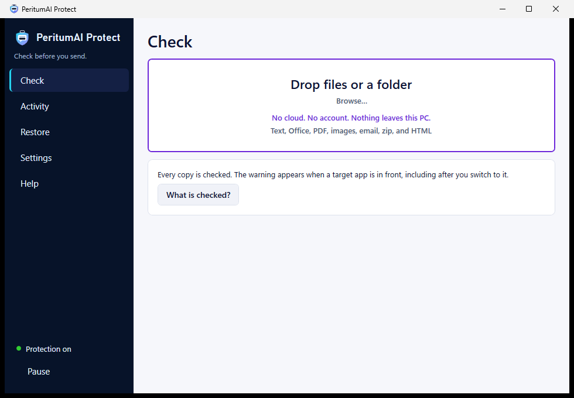

# PeritumAI Protect

**Protects what you give to AI.** A free Windows app that checks text and files for personal data, secrets and suspicious
links *before* you paste or upload them into ChatGPT, Claude, Copilot, Gemini or any other chat, and makes a safe copy.

- **Offline.** No account, no cloud, no telemetry. The app makes no network requests.
- **Rules, not AI.** Detection uses published rules, checksums and patterns. There is no AI model inside.
- **Your original stays untouched.** The app writes a new, protected copy next to it.
- **Free and open source** under the [Apache License 2.0](LICENSE).

> Version 1.0. It catches a lot, but not everything. Check the findings before you share important material.



## Download

Get the installer from [peritumai.com/protect](https://peritumai.com/protect) or from the
[Releases page](../../releases). Each release lists SHA-256 checksums; see [Verify your download](#verify-your-download).

Requirements: Windows 10 (version 1809 or later) or Windows 11, x64. The installer does not need administrator rights.

## What it does

- **Clipboard check.** When you copy an email address, a card number, an API key, an ID number or one of your own terms,
  and a browser or AI app is in front, it warns you and offers a redacted version to paste instead.
- **File check.** Drop a file or a folder: txt, md, csv, json, xml, html, docx, xlsx, pptx, pdf, eml, zip and images
  (read with Windows OCR on your PC). It lists each finding with where it is.
- **Protected copy and reversible copy.** Remove the findings for good, or swap them for tokens such as `[[EMAIL_1]]`
  that you can restore on your PC after the AI answers. Secrets are never restorable.
- **Clean for sharing.** Removes hidden content and metadata: comments, tracked changes, hidden sheets, speaker notes,
  macros, document properties and image GPS data.
- **Suspicious link check.** Flags lookalike domains, brand names in the wrong place and risky downloads in copied links
  and in emails and documents.
- **Profiles** for lawyers, clinics, accountants, HR, developers and journalists, and **country ID packs** for 16 countries.
- **Organization policy** through a JSON file or the registry (Group Policy, Intune).

Everything else, including limits and every setting, is in the [full guide](docs/USER-GUIDE.md).

## What it does not do

It is not an antivirus, an email filter or a browser extension. It does not check `.doc`, `.xls`, `.ppt`, `.rtf`, `.odt`
or `.msg` files, password-protected files or encrypted PDFs; those are reported as **Not checked**, never as clean.
See [What it does not check](docs/USER-GUIDE.md#what-it-does-not-check).

## Privacy

Nothing leaves your PC. Settings and an activity log of counts and rule names (never the values found) are stored in
`%LOCALAPPDATA%\Peritum\Protect\`. You can delete them from Settings → Data. Details: [PRIVACY.md](PRIVACY.md).

## Verify your download

Each release has a `SHA256SUMS.txt` file and a GitHub build attestation. In PowerShell:

```powershell
Get-FileHash .\PeritumAI-Protect-1.0.0-setup-x64.exe -Algorithm SHA256
```

The hash must match the line in `SHA256SUMS.txt`. With the GitHub CLI you can also check that the file was built by this
repository's release workflow:

```powershell
gh attestation verify .\PeritumAI-Protect-1.0.0-setup-x64.exe --repo peritumai/peritumai-protect
```

How signing works for this project: [docs/CODE-SIGNING-POLICY.md](docs/CODE-SIGNING-POLICY.md).

## Build from source

Install the [.NET 10 SDK](https://dotnet.microsoft.com/download) (x64), then:

```powershell
dotnet test PeritumProtect.sln
dotnet run --project src\Peritum.Protect.App
```

Release builds and the installer: [docs/RELEASING.md](docs/RELEASING.md).

## Contributing, security and support

- Bugs and ideas: [open an issue](../../issues). Please read [CONTRIBUTING.md](CONTRIBUTING.md) first.
- Security problems: **do not open a public issue**. Email security@peritumai.com. See [SECURITY.md](SECURITY.md).
- Everything else: danilo@peritumai.com.

## License

Copyright 2026 Danilo Stojković. Licensed under the [Apache License, Version 2.0](LICENSE). Third-party components are
listed in [THIRD-PARTY-NOTICES.md](THIRD-PARTY-NOTICES.md). The names "PeritumAI" and "PeritumAI Protect" and the logo are
not covered by the license; see [TRADEMARKS.md](TRADEMARKS.md).

This software is provided "as is", without warranty of any kind (License, sections 7 and 8). It helps you notice sensitive
data; it does not guarantee that nothing sensitive is left.
